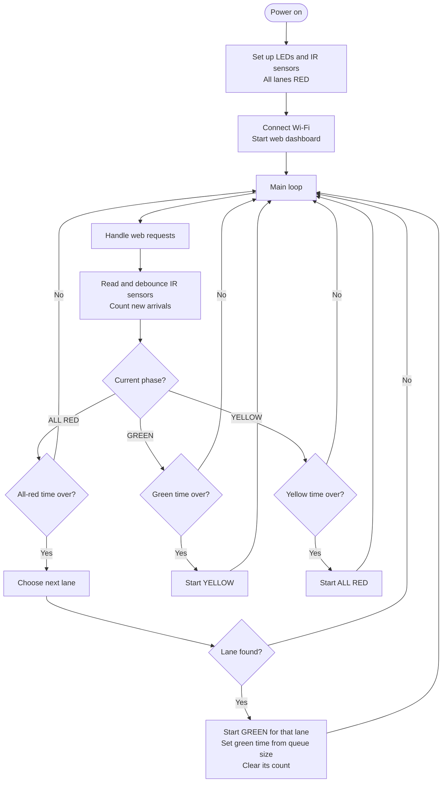
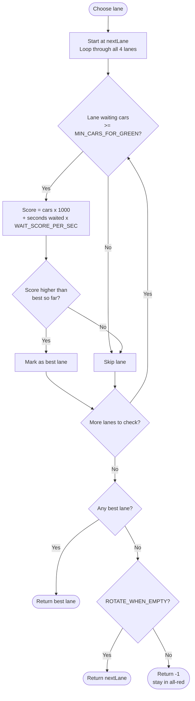
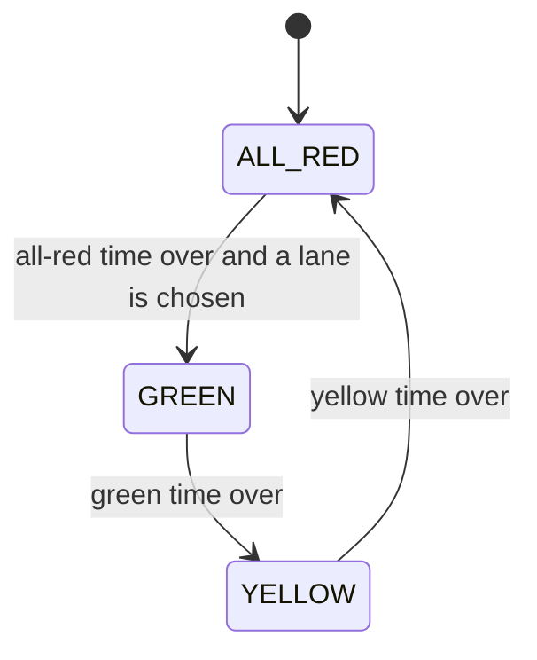

# ESP32 Smart Traffic Light

A 4-lane traffic light controller for the ESP32. IR sensors detect waiting cars, and the controller gives green to the busiest lane first. **Empty lanes are skipped.** A built-in web dashboard shows live lane status.

## Features

- Skips lanes with no waiting cars
- Busiest lane gets green first
- Starvation protection: lanes that wait a long time gain priority
- Adaptive green time based on queue length
- Debounced IR sensor input
- Live web dashboard (JSON polling, no page flicker)
- Traffic control keeps running if Wi-Fi fails, and Wi-Fi auto-reconnects

## Hardware

| Part | Qty |
|---|---|
| ESP32 dev board | 1 |
| Red, yellow, green LEDs | 4 each |
| Resistors for LEDs (about 220 to 330 ohm) | 12 |
| Digital IR obstacle sensors | 4 |

### Pin map

| Lane | Red | Yellow | Green | IR sensor |
|---|---|---|---|---|
| 1 | GPIO 4 | GPIO 16 | GPIO 17 | GPIO 15 |
| 2 | GPIO 18 | GPIO 19 | GPIO 21 | GPIO 22 |
| 3 | GPIO 26 | GPIO 33 | GPIO 32 | GPIO 35 |
| 4 | GPIO 12 | GPIO 14 | GPIO 27 | GPIO 13 |

Notes:
- GPIO 12 is a boot strapping pin and is deliberately **not** used.
- GPIO 35 is input-only with no internal pull-up, so the sketch uses `INPUT` and not `INPUT_PULLUP`.

## Setup

1. Open `smart_traffic_light.ino` in the Arduino IDE (ESP32 board package installed).
2. Set your Wi-Fi name and password:
   ```cpp
   const char* WIFI_SSID     = "YOUR_WIFI_NAME";
   const char* WIFI_PASSWORD = "YOUR_WIFI_PASSWORD";
   ```
3. Select your ESP32 board and port, then upload.
4. Open the Serial Monitor at **115200 baud**. The dashboard address is printed once Wi-Fi connects.
5. Visit that address in a browser on the same network.

## Configuration

| Constant | Default | Meaning |
|---|---|---|
| `MIN_CARS_FOR_GREEN` | 1 | Lanes with fewer waiting cars are skipped |
| `ROTATE_WHEN_EMPTY` | `false` | `false` = wait in all-red when no cars; `true` = keep rotating |
| `MIN_GREEN_MS` | 3000 | Base green time |
| `PER_CAR_MS` | 1000 | Extra green time per waiting car |
| `MAX_GREEN_MS` | 10000 | Maximum green time |
| `YELLOW_MS` | 2000 | Yellow duration |
| `ALL_RED_MS` | 2000 | All-red gap between lanes |
| `DEBOUNCE_MS` | 80 | Sensor debounce time |
| `WAIT_SCORE_PER_SEC` | 250 | Priority bonus per second a lane has waited |
| `DETECTED_LEVEL` | `LOW` | Sensor output level when a car is detected |

## How it works

### Overall flow



### Lane selection (`chooseLane`)



### Traffic phases



### What counts as a "waiting car"

- Each new detection on a lane that does not currently have green or yellow adds 1 to its count.
- If a car is sitting in front of a sensor and the count is 0, it still counts as 1 waiting car.
- When a lane gets green, its count is cleared.

## Web dashboard

- `/` shows the dashboard page
- `/data` returns JSON, used by the page every second:

```json
{
  "phase": "GREEN",
  "lanes": [
    { "waiting": 0, "light": "GREEN" },
    { "waiting": 2, "light": "RED" },
    { "waiting": 0, "light": "RED" },
    { "waiting": 1, "light": "RED" }
  ]
}
```

## Troubleshooting

| Problem | Likely cause and fix |
|---|---|
| Lane never gets green | Sensor not detecting, or `DETECTED_LEVEL` is wrong for your sensor. Try `HIGH`. |
| Lane always asks for green | Sensor permanently blocked or aimed at a nearby object. Re-aim or adjust its sensitivity. |
| ESP32 fails to boot with LEDs connected | A strapping pin (GPIO 0, 2, 5, 12, 15) is being held by a circuit. Disconnect it and retry. |
| Dashboard not loading | Check the IP in the Serial Monitor and that your phone or PC is on the same Wi-Fi network. |
| Lights stay all red | Expected when no cars are waiting and `ROTATE_WHEN_EMPTY` is `false`. |
